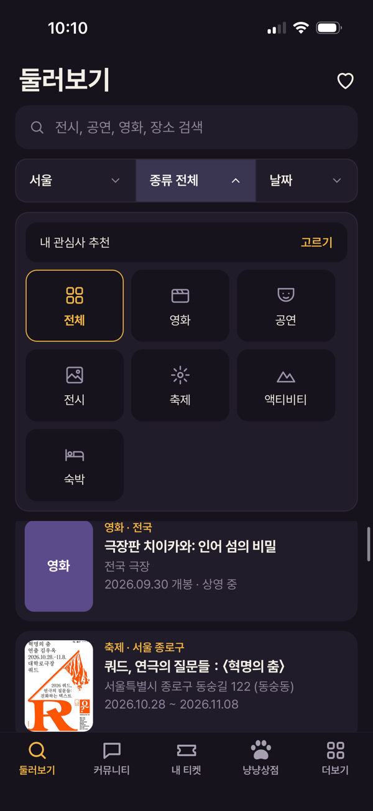
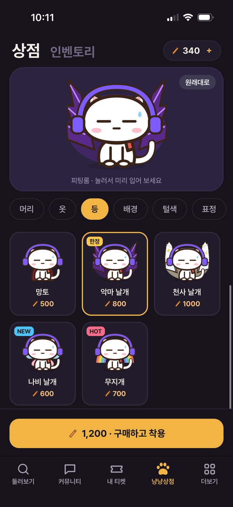

# 냥냥수첩 (Nyangnyang Notebook)

A personal culture log for iOS: keep every ticket you've seen, and find what to see next across Korea.

I built this for myself. I go to a lot of films, shows, exhibitions and festivals, and my records were scattered across ticket stubs, booking apps and photos. Finding what's on was just as scattered: each category lives in a different public database. This app pulls both sides into one place.

**Status:** shipped to TestFlight, 10 builds so far. Korean, English, Japanese and Simplified Chinese.

<p>
  
  &nbsp;
  
</p>

---

## What it does

| | |
|---|---|
| **Capture a ticket** | Photograph or scan a paper or mobile ticket. Claude reads it and fills in category, title, date, time, venue and seat. You review the fields before saving. |
| **Keep a record** | Your tickets, reviews, and an "original album" of the ticket images, shareable as a story image. |
| **Explore what's on** | Films, performances, exhibitions, festivals, activities and stays, filtered by region (17 regions), category and date, with links to booking apps and maps. |
| **Community** | Posts, reviews, friends and invite links. |
| **Cat avatar and shop** | Earn "churu" points by logging tickets and spend them on items for your cat avatar. No real-money purchases. |

## How the data flows

```
 Ticket photo ──► recognize (Edge Function) ──► Claude ──► validated fields ──► user reviews ──► tickets
                     JWT required, size/type checks         category whitelist,
                                                            200-char limit per field

 KOPIS (performances) ┐
 TourAPI (festivals,  ├─► sync-culture (daily, 04:00 KST) ──► culture_events ──► Explore tab
  exhibitions,        │      normalize region codes,            (one schema for
  activities, stays)  ┘      https images, booking links         every source)

 KOBIS (box office) ──► movies-live (real time, 10-min cache) ──► Explore tab
 KMDb (posters)     ──┘   not stored, per KOBIS terms of use
```

## Key decisions

- **One event schema for every source.** KOPIS uses its own region codes and XML; TourAPI uses different area codes and JSON. Both are mapped to one `culture_events` table with a shared region list, so the app filters every category the same way.
- **Respect each source's terms.** KOBIS box-office data must be used in real time, so films are queried live and never stored. Every screen that shows KOBIS or KMDb data credits the source.
- **AI reads, the user confirms.** Claude extracts ticket fields, but the output is validated on the server (fixed category list, length limits, no prices) and the user edits every field before anything is saved.
- **Start anonymous, sign in only when it matters.** Logging tickets needs no account. The first social action (friends, reviews, posts, invites) asks the user to sign in with Kakao, Google or Apple, and the anonymous account's data moves to the signed-in account.
- **Row-level security on every table.** The app ships only the public Supabase key; each user can read and write only their own records. Secret keys (Anthropic, public-data APIs, service role) live in Supabase function secrets and GitHub Actions secrets, never in the repository.

## Stack

- **App:** Expo (React Native), Expo Router, TypeScript
- **Backend:** Supabase (Postgres with RLS, Auth, Storage, Edge Functions on Deno, pg_cron)
- **AI:** Claude for ticket recognition and event translations
- **Public data:** KOPIS, Korea Tourism Organization TourAPI, KOBIS, KMDb
- **Release:** GitHub Actions → EAS Build → TestFlight

## How I built it

I defined the product, the data model and the priorities, and tested every build on my own phone. I used Claude Code as the engineer: most commits in this repository were written by Claude from my specifications, reviewed and merged by me through pull requests. Each feature started as a branch and a PR, which is why the history reads as a series of small, scoped changes.

## Run it locally

```sh
npm install --legacy-peer-deps
cp .env.example .env        # public Supabase URL and publishable key
npx expo start
```

Backend setup (migrations, Edge Function secrets, daily sync, sign-in providers) is in [`supabase/README.md`](supabase/README.md).
